# NextBastion 堡垒机

> 轻量级自研堡垒机 · Python 3.11 + FastAPI + MySQL 8 + 原生 HTML5 SPA
> 浏览器真实 SSH/RDP 终端 · 全程录像审计 · 高危命令实时拦截 · Webhook 告警 · TOTP 双因子 · LDAP 目录认证 · Web SFTP 文件管理 · 三轮渗透加固

一个 **单文件前端 + FastAPI 后端** 的轻量堡垒机，专为中小团队内网运维设计：
无需 Java 中间件（SSH 通道原生 asyncssh），10 分钟完成部署，开箱即用。

---

## ✨ 功能特性

| 模块 | 功能 |
|------|------|
| **认证** | 账号密码 + TOTP 双因子（Google Authenticator，防重放）；**admin 角色强制 MFA**（可应急旁路）；登录锁定（5 次失败锁 15 分钟）+ IP 限流 |
| **会话管控** | 并发登录会话上限（每用户 5 个 access token，新登录挤掉最旧） |
| **资产** | 资产 / **节点树管理**（树形增删改移、防环、资产计数）/ 托管账号（AES-256-GCM，接口不回显），分组标签、字段字典化 |
| **授权** | 五维授权：用户/用户组 × 资产/节点 × 托管账号 × 时段 × 命令过滤策略；节点授权覆盖整棵子树 |
| **角色** | 内置 3 角色（admin/auditor/user）+ **28 项能力 × 6 分组权限矩阵** + 默认角色 + 批量改角色（防自降权/最后管理员保护） |
| **接入** | 浏览器 Web SSH 终端（WebSocket + asyncssh），全程 asciinema cast 录像 |
| **接入** | RDP 图形通道（guacd 承载，可选安装） |
| **文件管理** | **Web SFTP**：浏览/上传（分片断点续传）/下载/重命名/删除（回收站）；默认打开账号家目录；高危目录下载留证副本（SHA256） |
| **审计** | 在线会话实时监控 / 一键强断；会话历史 + 录像回放；命令审计 + 高危**阻断/告警**；文件传输审计 |
| **仪表盘** | 运行概览 + **高危命令明细清单**（今日/全部切换，服务端分页） |
| **告警** | 高危命令实时 Webhook 推送（钉钉/企微兼容）；Syslog 转发（事件级勾选） |
| **目录认证** | LDAP 对接：**角色组映射**（目录组 DN → 角色，多命中取最高）+ 用户全量同步 + LDAP 直接登录 |
| **审计日志** | 服务端分页（20/50/100），筛选 + CSV 导出 |

## 🛡️ 安全加固记录（三轮渗透测试驱动）

本项目经过 **3 轮授权渗透测试 + 1 次全量密钥轮换**，共发现并修复 **18 项**安全问题：

| 轮次 | 修复项 |
|------|--------|
| 第一轮 | XFF 限流绕过、refresh 异常回显 |
| 第二轮 | SFTP 任意路径写入（cron/authorized_keys RCE）、敏感文件下载、self-bastion 自我接管、Webhook SSRF；路径规范化矩阵加固（`//`、`./`、`..`、`%00`、大小写等 30 项变体全拦截）+ JWT/凭据/DB 密钥全量轮换 |
| WS 专项 | refresh token 过 WebSocket、会话监视无属主绑定 |
| 第三轮 | API 文档暴露（/docs 关闭）、明文 8000 直连（仅留 Nginx TLS 入口）、版本指纹、admin 强制 MFA、并发会话上限、XSS 入库净化（纵深防御）、MySQL/LDAP 监听面收敛 |

回归测试 **58 项全绿**（含 30 项路径安全变体矩阵、MFA 强制/旁路双态用例），详见 [docs/PRD-安全测试第三轮-问题与方案.md](docs/PRD-安全测试第三轮-问题与方案.md)。

## 🧱 技术栈

- **后端**：Python 3.11 · FastAPI · asyncssh · PyMySQL · PyJWT · pyotp · ldap3 · cryptography(AES-GCM)
- **前端**：原生 SPA（零构建，单 index.html）· xterm.js · asciinema-player · guacamole-common.js
- **存储**：MySQL 8（14 张业务表，含会话表/撤销表）
- **目录**：OpenLDAP / 389-DS（LDAPS，可选）
- **部署**：一键 Shell 脚本（systemd + Nginx TLS 反代 + firewalld + 运维定时器）

## 🖥️ 测试环境页面预览

| 页面 | 截图 |
|------|------|
| 登录（TOTP 双因子） | 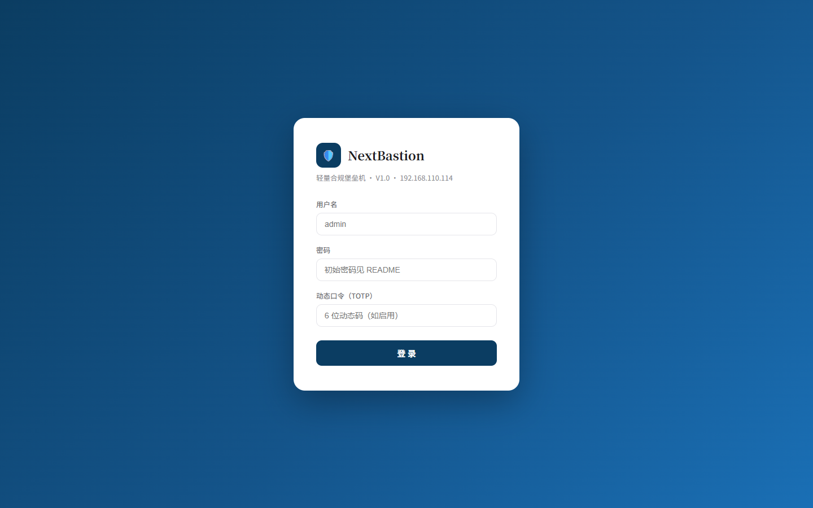 |
| 仪表盘（高危命令明细） | 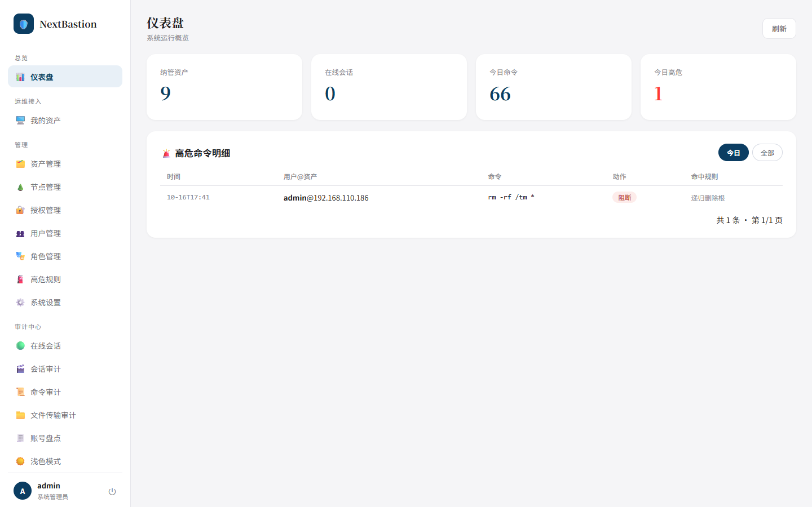 |
| 我的资产（授权过滤） | 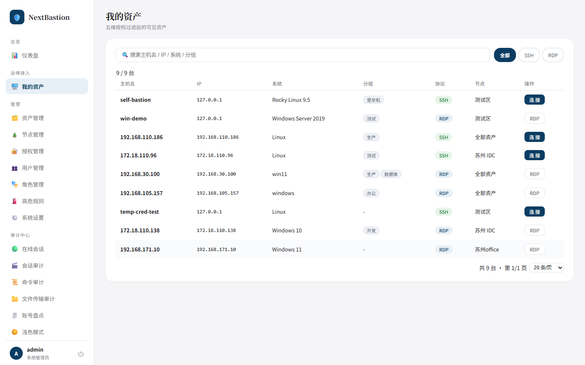 |
| 资产管理 | 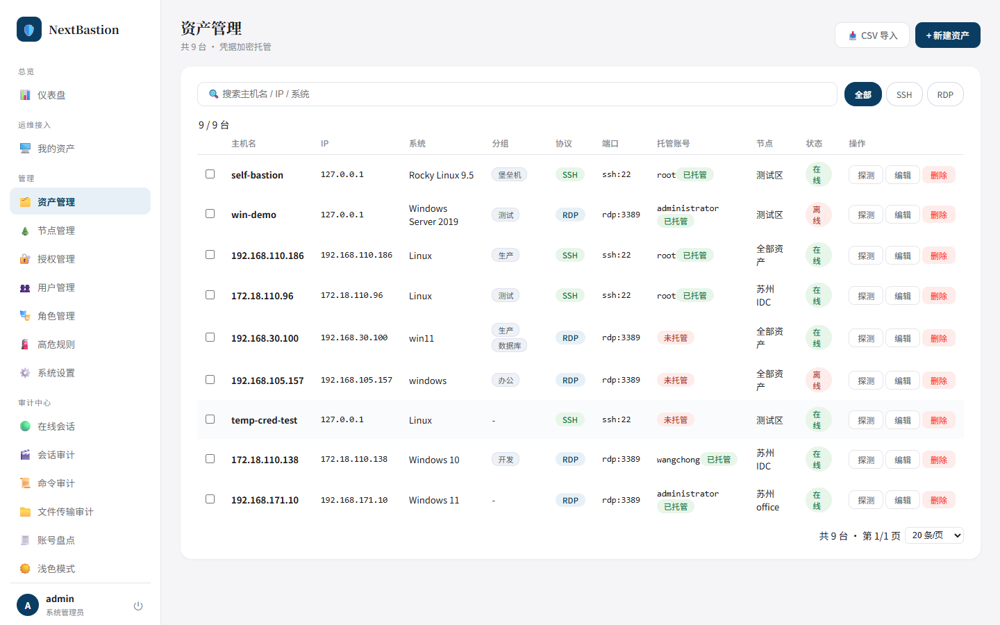 |
| 节点管理（树形） | 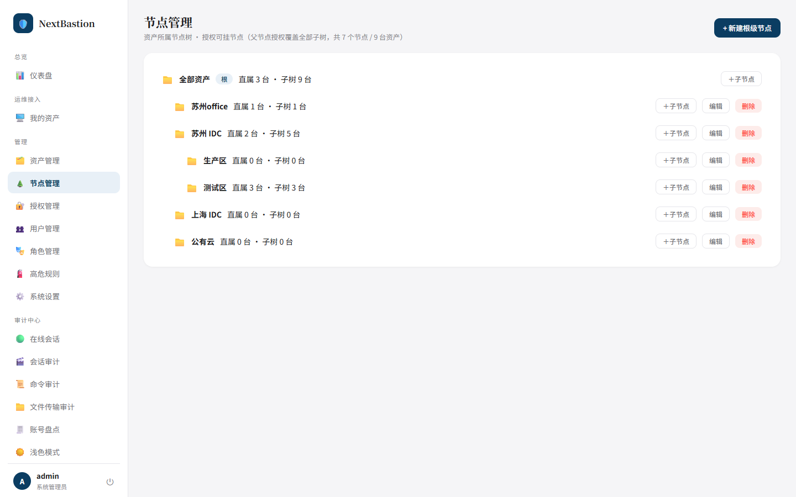 |
| 授权管理（五维策略） | 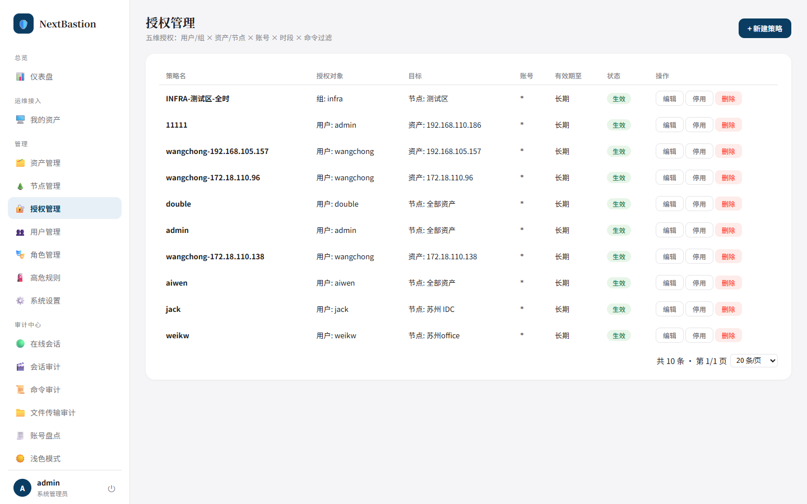 |
| 用户管理 | 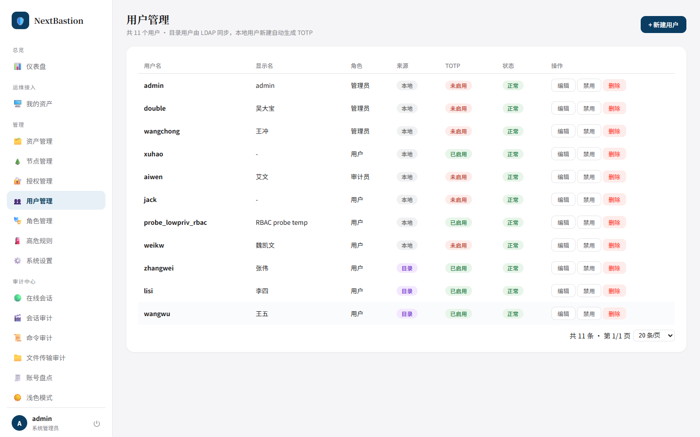 |
| 角色管理（权限矩阵） | 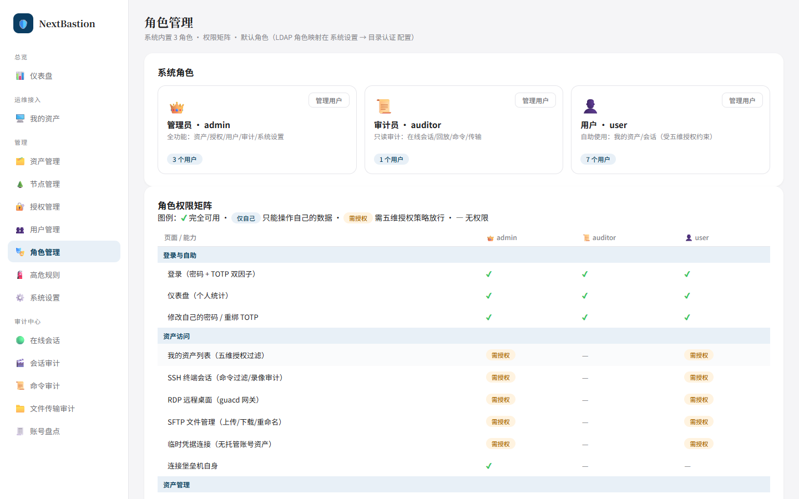 |
| 在线会话（实时监控） | 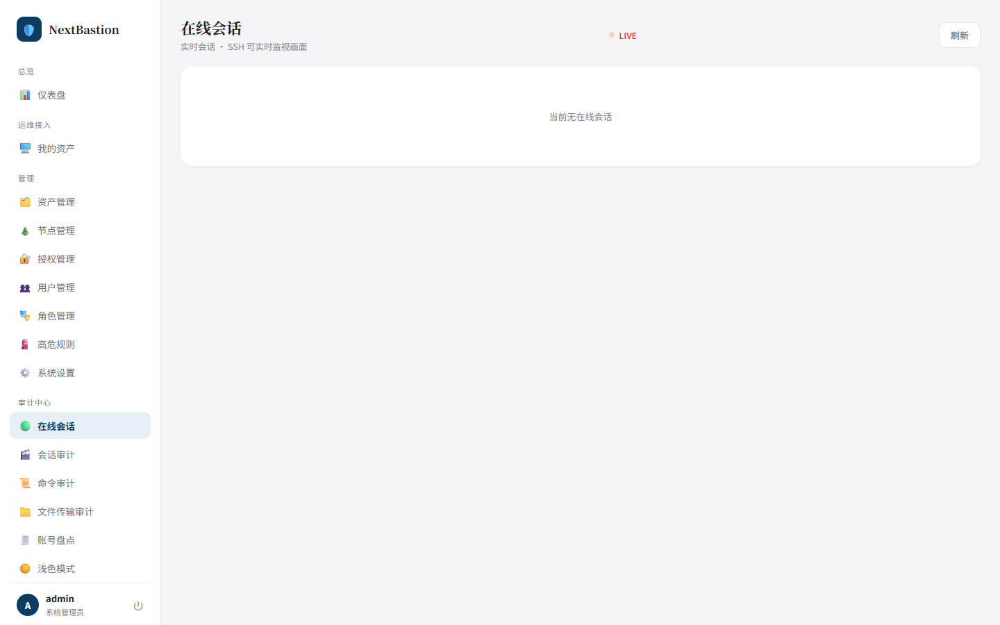 |
| 系统设置（LDAP/Webhook） | 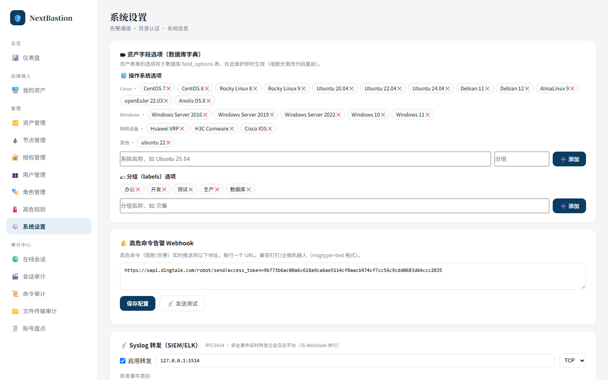 |
| Web SFTP 文件管理 | 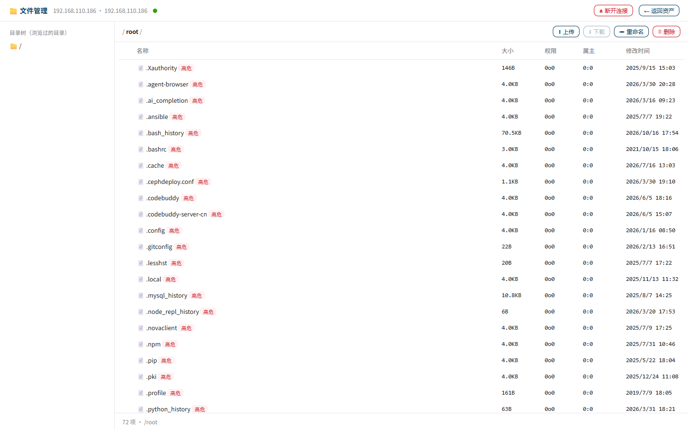 |

> 测试环境：Rocky Linux 9 · https://192.168.110.114 · V1.2

## 📦 项目结构

```
NextBastion/
├── app/                      # 应用源码
│   ├── main.py               # FastAPI 路由（全部 REST + WebSocket API，含安全层）
│   ├── config.py             # 配置（环境变量驱动）
│   ├── utils.py              # DB 连接 / JWT / AES-256-GCM 凭据加密 / 审计公共库
│   ├── db_init.py            # 建库建表 + 种子数据
│   ├── seed.py               # 初始账号/演示资产
│   ├── ldap_auth.py          # LDAP 认证 + 角色组映射 + 全量同步
│   ├── fileman.py            # Web SFTP 文件管理（含路径安全层：规范化/黑名单/审计）
│   ├── guac_bridge.py        # RDP-guacd 桥接（一次性 token）
│   ├── account_scan.py       # 账号盘点扫描
│   ├── syslog_fwd.py         # Syslog 转发
│   ├── requirements.txt
│   └── web/                  # 前端 SPA（index.html + fileman.html + 播放器 + vendor）
├── deploy.sh                 # ★ 一键部署脚本（幂等）
├── migrations/               # 增量 SQL（LDAP/TOTP 绑定等）
├── scripts/                  # 运维脚本（LDAP 同步/日志清理 → systemd timer）
├── tests/
│   ├── api_regression.py     # 58 项 API 回归（含安全变体矩阵、MFA 双态）
│   ├── frontend_regression.js# 前端 E2E（Playwright）
│   └── run_all.sh
├── prd/                      # 产品需求文档
│   ├── PRD-NextBastion堡垒机.md
│   └── PRD-LDAP对接.md
├── docs/
│   ├── PRD-角色管理.md        # 角色管理改造 PRD（A1+B1+C1 方案）
│   ├── PRD-安全测试第三轮-问题与方案.md
│   ├── 角色权限矩阵.md
│   └── screenshots/          # 测试环境页面截图
└── README.md
```

## 🚀 安装（一键部署）

### 环境要求

- Rocky Linux 9 / CentOS 9 / RHEL 9（EL9 系）
- root 权限，可访问外网（dnf + pip）
- （可选）OpenLDAP/389-DS 目录服务、guacd 所需编译工具链

### 三步部署

```bash
# 1. 获取代码
git clone http://sso-git.greatld.com/nextops/nextbastion.git && cd nextbastion

# 2. 一键部署
bash deploy.sh

# 3. 需要 RDP 图形通道（可选，编译 guacd 约 5-10 分钟）
NB_WITH_RDP=1 bash deploy.sh
```

部署脚本自动完成：系统依赖 → MySQL 初始化（`bind-address=127.0.0.1`）→ venv → 密钥生成 → 建库建表 → 种子数据 → systemd（uvicorn 仅监听 `127.0.0.1:8000`）→ Nginx TLS 反代 → 防火墙 → 运维定时器 → 健康检查。

完成后终端打印初始账号与 TOTP 绑定信息（服务器 `/opt/nextbastion/INITIAL_CREDENTIALS.txt` 同步留存，**首次登录改密后建议删除**）。

### 自定义口令（可选）

```bash
NB_MYSQL_ROOT_PASS='你的root密码' \
NB_DB_PASS='你的应用库密码' \
NB_ADMIN_PASS='你的admin密码' \
bash deploy.sh
```

| 环境变量 | 默认值 | 说明 |
|----------|--------|------|
| `NB_MYSQL_ROOT_PASS` | ChangeRoot@2026 | MySQL root 密码 |
| `NB_DB_PASS` | ChangeMe@2026 | 应用库 nextbastion 密码 |
| `NB_ADMIN_PASS` | Admin@2026 | admin 初始密码 |
| `NB_PORT` | 8000 | 后端监听端口（仅本机） |
| `NB_WITH_RDP` | 0 | 1 = 安装 guacd（RDP） |
| `NB_NO_MFA` | 0 | 1 = 跳过 TOTP 初始化（不推荐） |

### 首次登录

1. 浏览器访问 `https://<服务器IP>`（Nginx 443，自签证书首次需确认）
2. 手机安装 **Google Authenticator** → 添加账号 → 输入部署输出中的 Secret
3. 登录：`admin` + 初始密码 + 6 位动态码
4. **立即修改初始密码**（用户管理 → 编辑 admin）

---

## 📖 使用说明

### 快速上手（管理员）

```
添加资产 → 配置授权 → 用户连接 → 审计回放
```

1. **资产管理** → 新建资产（主机名/IP/协议/端口/系统/分组）→ 添加托管账号（加密存储）
2. **节点管理** → 维护组织树（如 苏州 IDC/生产区）；授权挂父节点 = 覆盖整棵子树
3. **授权管理** → 新建策略（用户 × 资产/节点 × 账号 × 时段 × 命令过滤；可勾选 SFTP 文件传输能力）
4. **角色管理** → 查看权限矩阵、设默认角色、批量调整用户角色
5. 用户在 **我的资产** 点「连接」→ Web 终端；点「文件」→ Web SFTP

### 高危命令防护

- `rm -rf /`、`shutdown`、`DROP DATABASE` 等 → **直接阻断** + 实时告警
- `chmod 777`、`iptables -F` 等 → 放行但**记录高危 + Webhook 推送**
- 规则页可维护规则集；授权策略可绑定差异化规则集

### Web SFTP 文件管理

- 授权策略需勾选「文件传输」能力；默认打开账号家目录
- 上传分片 + 断点续传；删除进 `.nb-trash` 回收站
- 安全层：路径规范化（拒 `..`/`//`/`%00` 等）、敏感路径/文件名/后缀三级黑名单、高危目录下载自动留证（SHA256）、全部操作审计

### LDAP 目录认证（可选）

系统设置 → 目录认证 → 连接参数 + **角色组映射**（目录组 DN → admin/auditor/user，多命中取最高，未命中走默认角色）→ 测试连接 → 全量同步。每日定时自动同步，离职用户自动 suspended。

### 审计

| 页面 | 功能 |
|------|------|
| 仪表盘 | 概览 + 高危命令明细（今日/全部，分页） |
| 在线会话 | 实时监控（SSH 画面直播）+ 一键强断 |
| 会话审计 | 历史列表 + **终端录像回放** + CSV |
| 命令审计 | 全量检索（FULLTEXT 加速）+ CSV |
| 文件传输审计 | SFTP 操作流水 + 留证副本 |

---

## 🌐 API 概览（前缀 `/api/v1`，JWT Bearer）

| 方法 | 路径 | 说明 |
|------|------|------|
| POST | /auth/login | 登录（username/password/totp） |
| POST | /auth/refresh | 刷新 token（7 天） |
| GET | /auth/me | 当前用户 |
| GET/POST/PUT/DELETE | /assets · /nodes · /users · /policies | 资产/节点/用户/策略管理 |
| GET/PUT | /role-settings · /role-matrix | 角色设置/权限矩阵 |
| POST | /users/batch-role | 批量改角色 |
| GET | /my/assets | 我的授权资产 |
| POST | /files/{asset}/{account}/session | SFTP 会话（含家目录解析） |
| GET/POST | /files/{fsid}/list·stat·upload·download·op | 文件管理（统一安全层） |
| GET | /sessions · /sessions/active · /sessions/{id}/cast | 会话审计/在线/录像 |
| GET | /commands?q=&page= · /files/transfers | 命令/传输审计 |
| GET | /dashboard/stats · /dashboard/highrisk | 仪表盘 |
| POST | /temp-cred | 临时凭据（限流 10 次/10 分钟） |
| WS | /ws/terminal/{asset}/{account}?token= | SSH 终端 |
| WS | /ws/live/{sid}?token= | 实时监视（属主绑定） |
| WS | /ws/guac/{token} | RDP 通道（kind=rdp 一次性） |
| GET | /health | 健康检查（无版本指纹） |

> 生产环境已关闭 /docs /redoc /openapi.json（防 API 蓝图泄露）；开发调试可在 main.py 中恢复。

**调用示例**：

```bash
# 登录（MFA 用户带 totp）
curl -sk -X POST https://<IP>/api/v1/auth/login \
  -H "Content-Type: application/json" \
  -d '{"username":"admin","password":"***","totp":"123456"}'

# 带.token 查资产
curl -sk https://<IP>/api/v1/assets -H "Authorization: Bearer <access_token>"
```

## 🔧 常用运维命令

```bash
systemctl status nextbastion        # 服务状态
systemctl restart nextbastion       # 重启
journalctl -u nextbastion -f        # 实时日志
systemctl list-timers 'nb-*'        # LDAP 同步/清理定时器

# 源码更新后重新部署（幂等，不影响已有数据）
cd <源码目录> && bash deploy.sh

# 跑全量回归（服务器上）
/opt/nextbastion/venv/bin/python tests/api_regression.py
```

### 线上数据目录

```
/opt/nextbastion/
├── app/                        # 应用代码
├── venv/                       # Python 虚拟环境
├── records/                    # 会话录像 + 文件留证副本
├── logs/                       # 运维脚本日志
├── .secrets                    # JWT/凭据加密密钥（600 权限 ⚠️ 勿删勿泄，请异地备份）
└── INITIAL_CREDENTIALS.txt     # 初始凭据（改密后建议删除）
```

## ⚠️ 安全须知

1. `.secrets` 是凭据加密根密钥，**删除后所有托管密码不可恢复**；更换密钥需同步重加密 `asset_accounts` 与 `ldap_config.bind_pw_enc`（历史上漏过一次，已修）。
2. 上线前必做：修改 admin 初始密码、更换 MySQL 默认口令、Nginx 挂正式 TLS 证书、**admin 绑定 TOTP**（系统强制管理员双因子，应急旁路文件 `/opt/nextbastion/.admin_mfa_off` 用完即删）。
3. 最小权限：运维用户 `user`；审计 `auditor`（只读+强断）；管理界面仅 `admin`。
4. 网络面：仅暴露 Nginx 443；MySQL/uvicorn 仅回环；LDAP 仅 LDAPS 636；guacd 仅 127.0.0.1:4822。
5. 密钥轮换 SOP：JWT_SECRET/CRED_KEY/DB 密码一起换，凭据表必须随轮换重加密，轮换后全员重新登录。

## 🧪 测试

```bash
# API 回归（58 项：功能 + 安全变体矩阵 + MFA 双态）
bash tests/run_all.sh
# 或
/opt/nextbastion/venv/bin/python tests/api_regression.py
```

覆盖：认证/授权/资产/节点/角色/用户/SFTP 全链路（含 30 项路径攻击变体）/会话/审计/仪表盘高危明细/高危规则/上传下载/Webhook 配置等。

## 🗺️ 路线图

- [x] V1.0 核心（认证/资产/授权/SSH 终端/录像/审计/高危拦截）
- [x] V1.0.2 Webhook 告警、字段字典、审计分页
- [x] V1.1 Web SFTP 文件管理、TOTP 防重放、临时凭据、账号盘点
- [x] V1.2 节点树管理、角色管理（矩阵/默认角色/批量）、LDAP 角色组映射、仪表盘高危明细、三轮渗透加固 18 项、密钥轮换
- [ ] V1.3 会话根白名单（chroot 模型）、主机侧最小权限 SFTP 账号
- [ ] V2 RDP 录像导出、多节点部署、开放 API

## 📄 文档

- [PRD-NextBastion堡垒机.md](prd/PRD-NextBastion堡垒机.md) —— 完整产品需求
- [PRD-LDAP对接.md](prd/PRD-LDAP对接.md) —— LDAP 对接设计
- [PRD-角色管理.md](docs/PRD-角色管理.md) —— 角色管理改造
- [PRD-安全测试第三轮-问题与方案.md](docs/PRD-安全测试第三轮-问题与方案.md) —— 三轮渗透与修复闭环
- [角色权限矩阵](docs/角色权限矩阵.md)

---

© 2026 nextops · NextBastion
